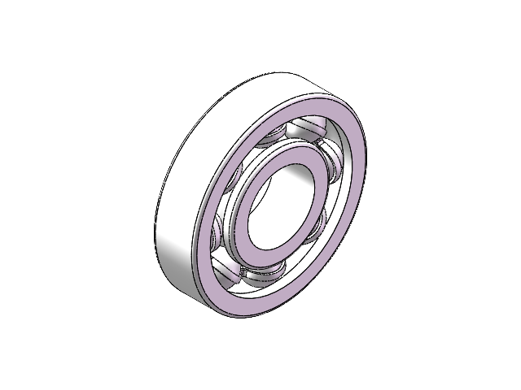
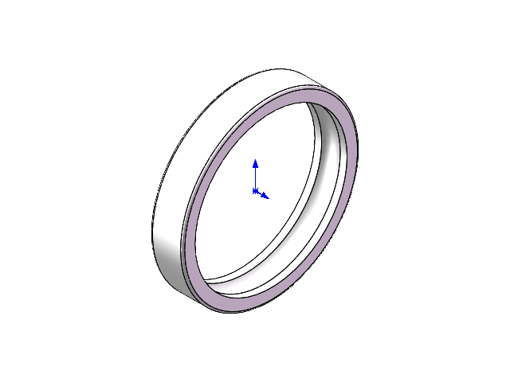
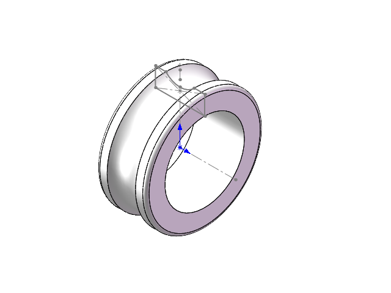
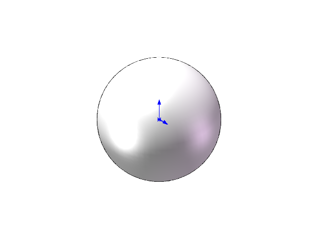
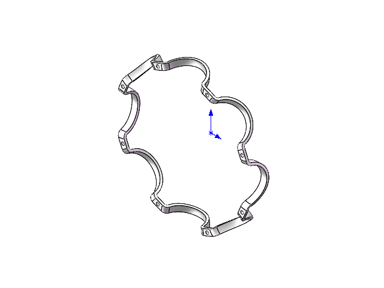
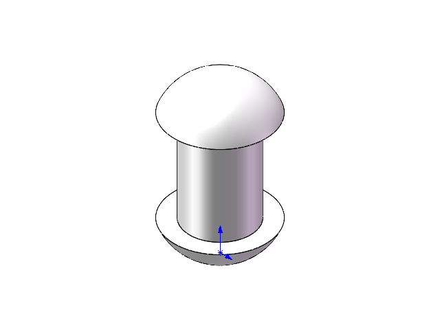

# 滚珠轴承 · SOLIDWORKS 三维建模与装配

[English](README.en.md) · [模型说明](docs/MODEL_NOTES.md) · [上传指南](docs/PUBLISHING.md) · [版权声明](LICENSE)

一个个人机械建模项目，展示滚珠轴承的零件结构与装配关系。仓库保存 SOLIDWORKS 原生装配体、五类零件及真实模型预览，便于浏览作品、检查模型和交流建模思路。



> 预览图直接提取自对应 CAD 文件内保存的 PNG，未重新渲染。项目按“公开展示、保留所有权利”发布，具体使用范围见 [LICENSE](LICENSE)。

## 项目内容

- **原生模型**：1 个 `.SLDASM` 装配体、5 个 `.SLDPRT` 零件文件。
- **组件结构**：内圈、外圈、滚珠、钢球架及紧固件。
- **装配快照**：保存的默认配置包含 20 个未压缩、计入 BOM 的零件实例。
- **在线展示**：装配体及全部五类零件均有 PNG 预览，无需打开 CAD 即可浏览。
- **交付说明**：附文件校验清单、打开方法、维护说明及 GitHub 上传步骤。

## 零件与数量

下表数量来自装配文件保存的组件实例树，**不是在 SOLIDWORKS 中重新生成的物料清单**。一个零件文件可在装配中被多次引用。

| 零件 | 原生文件 | 默认配置实例数 | 结构角色 |
| --- | --- | ---: | --- |
| 轴承外圈 | [轴承外圈.SLDPRT](轴承外圈.SLDPRT) | 1 | 外侧套圈及滚道 |
| 轴承内圈 | [轴承内圈.SLDPRT](轴承内圈.SLDPRT) | 1 | 内侧套圈及滚道 |
| 滚珠 | [滚珠.SLDPRT](滚珠.SLDPRT) | 8 | 滚动体 |
| 钢球架 | [钢球架.SLDPRT](钢球架.SLDPRT) | 2 | 保持架组件 |
| 紧固件 | [紧固件.SLDPRT](紧固件.SLDPRT) | 8 | 连接保持架的紧固零件 |
| **合计** | **5 类零件文件** | **20** | 装配入口：[滚珠轴承.SLDASM](滚珠轴承.SLDASM) |

## 零件预览

| 轴承外圈 | 轴承内圈 |
| :---: | :---: |
|  |  |
| 滚珠 | 钢球架 |
|  |  |

<details>
<summary>查看紧固件预览</summary>



</details>

部分零件的原始预览保留了草图或坐标标记，反映文件最后保存时的显示状态。

## 打开模型

1. 下载整个仓库，或使用 Git 克隆后在本地打开；ZIP 下载完成后先解压。
2. 保持六个原生 CAD 文件位于同一文件夹，并保留原有中文文件名。
3. 使用兼容文件保存版本的 **SOLIDWORKS** 打开根目录的 `滚珠轴承.SLDASM`。
4. 选择保存的“默认”配置，检查组件加载情况，并执行完整重建（`Ctrl + Q`）。
5. 如果出现缺失引用，在打开对话框的引用设置中定位到本地同名零件，再重新检查装配。

仅浏览作品可直接查看本页预览图。**模型的具体保存版本及可用软件版本仍需在 SOLIDWORKS 中确认**；文件内的版本字段记录在[模型说明](docs/MODEL_NOTES.md)中，不视作兼容性测试结果。

装配体具有外部文件引用，不能只下载 `.SLDASM`。引用检查方法可参考 [SOLIDWORKS 官方 Find References 说明](https://help.solidworks.com/2024/English/SolidWorks/Sldworks/HIDD_FINDREFERENCES_HELP.htm)。

## 仓库结构

```text
.
├── 滚珠轴承.SLDASM          # 装配入口
├── 轴承外圈.SLDPRT
├── 轴承内圈.SLDPRT
├── 滚珠.SLDPRT
├── 钢球架.SLDPRT
├── 紧固件.SLDPRT
├── assets/previews/         # 六张来自模型文件的真实预览
├── docs/
│   ├── MODEL_NOTES.md       # 检查依据、组件关系和待验证事项
│   ├── PUBLISHING.md        # 仓库名称、简介、Topics 和上传步骤
│   └── model-manifest.json  # 文件大小、SHA-256、数量和预览映射
├── scripts/check_repository.py
├── .github/                # 仓库检查工作流、Issue 和 PR 模板
├── .gitattributes          # 原生 CAD 文件按二进制管理
├── .gitignore              # 忽略锁文件、备份及本地缓存
├── CONTRIBUTING.md
├── LICENSE
├── README.md
└── README.en.md
```

原生 CAD 文件合计约 **1.37 MiB**，当前文件集可直接使用普通 Git 管理；本仓库未配置 Git LFS。

## 文件完整性检查

使用 Python 3.10 或更高版本运行以下命令，无需安装第三方依赖：

```bash
python scripts/check_repository.py
```

脚本检查原生文件及预览是否齐全、SHA-256 是否与清单一致，以及 Markdown 中的本地文件链接是否有效。GitHub Actions 会在推送和 Pull Request 时执行相同检查。

这项检查不打开 CAD、不求解配合，也不验证几何或制造可行性。模型更新后应同步更新预览、清单和相关说明，详见[维护指南](CONTRIBUTING.md)。

## 验证范围与后续完善

当前已核对六个原生文件、保存的组件实例树及六张内嵌预览。尚未在 SOLIDWORKS 中执行重建、配合求解、干涉检查或尺寸复核。

后续可进一步补充：

- 确认过的 SOLIDWORKS 版本与重建结果；
- 隐藏草图后的清晰截图、剖视图、爆炸图和装配动画；
- 经复核的尺寸、材料、公差及工程图；
- 从原装配导出的 STEP 等中性格式。

当前交付内容用于建模作品展示与技术交流，未作为经过工程验证的制造资料发布。模型的参数、材料和承载性能不作未经验证的声明。

## 交流与版权

打开问题、文件缺失或文档错误可通过 Issue 反馈，请附软件版本、问题文件和复现步骤。提交修改前请阅读 [CONTRIBUTING.md](CONTRIBUTING.md)。

**保留所有权利。**公开展示不额外授予修改、再分发或商业使用许可；适用法律和 GitHub 服务条款允许的行为不受本声明限制。完整声明见 [LICENSE](LICENSE)。关于公开仓库与授权的区别，可参阅 [GitHub 官方许可说明](https://docs.github.com/en/repositories/managing-your-repositorys-settings-and-features/customizing-your-repository/licensing-a-repository)。
